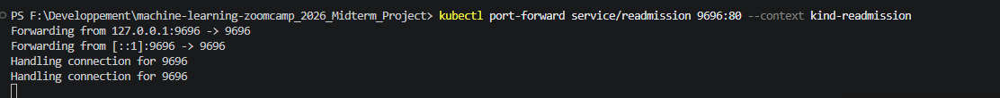
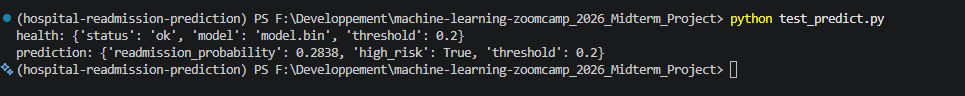
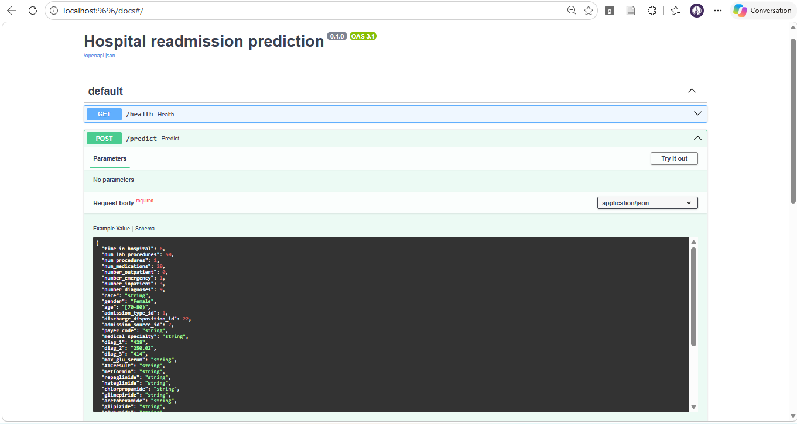

# Hospital Readmission Prediction

Predict whether a diabetic patient will be readmitted to the hospital within 30 days of
discharge. ML Zoomcamp 2026 midterm project.

## Problem description

Unplanned hospital readmissions within 30 days of discharge are a major burden for
patients and for health systems everywhere, but the problem is especially acute in
resource-constrained settings. When a patient is discharged too early, or without a
workable follow-up plan, the condition that brought them to hospital is likely to
come back and the second admission is often more severe than the first. The patient
loses time, income and sometimes their life; the hospital spends scarce beds, staff
and drugs on a case that could have been managed on an outpatient basis.

Diabetes is a good illustration. It is a chronic, medically complex disease with
frequent cardiovascular, renal and metabolic complications, and its prevalence is
rising in low- and middle-income countries. In **Burkina Faso**, as in many
low-income countries, diabetes care is largely concentrated in urban referral
hospitals such as the university hospitals (CHU) of Ouagadougou and
Bobo-Dioulasso. While a large share of the population lives outside these cities
and relies on the network of primary health centres (CSPS) and community health
workers for follow-up . A patient discharged from a referral hospital
after a diabetes-related admission may therefore live far from the centre, may not
be able to afford the full course of medication, and may have no one checking on
them during the first weeks after discharge. In this context, the difference between
a patient who is called back, seen early, and supported with their treatment, and a
patient who is simply sent home, can be the difference between recovery and a
life-threatening readmission. The same logic applies to referral hospitals in other
low-resource settings, and to under-served populations within wealthier countries.

The dataset used in this project was collected in **130 US hospitals** (1999–2008),
so the absolute readmission rates and the relative importance of some predictors
reflect the US healthcare context. The model itself, however, is **not** tied to that
context: its inputs (demographics, admission details, diagnoses, lab results,
medications, prior utilisation) are routinely collected at admission and discharge
in most hospitals. On paper or electronically, and with varying completeness (for
instance, an HbA1c test is not always ordered). Its output is a **risk score** that
ranks patients by their probability of returning within 30 days. The point of the
project is to show that such a score can be built and evaluated on real, messy
clinical data, and that the same pipeline can be retrained on local data (for
instance from CHU Yalgado Ouédraogo or CHU Sourô Sanou) before being used in a
given hospital.

**Who uses the model, and when.** The intended user is the **care team at the
moment of discharge** — the physician who signs the discharge order, the nurse who
prepares the exit, and, where it exists, the social worker or community health
worker who will follow the patient afterwards. The model takes information that is
already available in the medical record at discharge time and produces a risk score
in a few seconds, so it does not require any extra data collection.

**What they do with it.** The score is used to **prioritise follow-up**. Patients
in the highest-risk group can be flagged for a follow-up phone call within a few
days, an earlier outpatient appointment, a medication review, or a home visit by a
community health worker. In a hospital where staff and transport are limited, it is
impossible to follow up every discharged patient — the score helps direct those
scarce resources to the patients who need them most. It is a decision-support tool,
not a decision-maker: the care team remains free to override it.

**How success is measured.** The target is **ROC AUC** on held-out patients. Only
about 11 % of encounters in the dataset end with a readmission within 30 days, so
the classes are heavily imbalanced and accuracy is misleading — a model that always
predicts “no readmission” would already be right ~89 % of the time while being
useless. ROC AUC measures how well the model **ranks** patients by risk, which is
exactly what the care team needs to decide who gets the limited follow-up slots.
For the same reason, when we later move to a local deployment, we would monitor the
**top-k precision** (how many of the patients flagged as high-risk are actually
readmitted) alongside ROC AUC, because that directly reflects the operational cost
of false positives.

## Dataset

[Diabetes 130-US Hospitals for Years 1999-2008](https://archive.ics.uci.edu/dataset/296/diabetes+130-us+hospitals+for+years+1999-2008)
(UCI Machine Learning Repository, CC BY 4.0).

- 101,766 hospital encounters of 71,518 patients, 50 columns.
- Target: `readmitted == "<30"` (11.2% of encounters).

The archive is committed as [`data/data.zip`](data/data.zip). Extract it with:

```bash
uv run python data/download_data.py
```

The script verifies the archive's SHA-256 checksum and downloads it from UCI if it is missing.

## Project structure

| File | Content |
|---|---|
| `notebook.ipynb` | Data cleaning, EDA, feature importance, model selection and tuning |
| `readmission.py` | Data cleaning and feature preparation shared by `train.py` and `predict.py` |
| `train.py` | Trains the final model and saves it to `model.bin` |
| `model.bin` | Trained model (`DictVectorizer` + XGBoost booster) |
| `predict.py` | Loads the model and serves it with FastAPI |
| `test_predict.py`, `examples/patient.json` | Sends an example patient to the service |
| `Dockerfile` | Container for the prediction service |
| `deploy/kubernetes/` | Kubernetes manifests and deployment script (kind) |
| `pyproject.toml`, `uv.lock` | Dependencies |

## Setup

This project uses [uv](https://docs.astral.sh/uv/) to manage the Python version, the virtual
environment and the dependencies.

```bash
# install uv: https://docs.astral.sh/uv/getting-started/installation/
uv sync                                  # creates .venv/ with the locked dependencies
uv run python data/download_data.py      # extracts the dataset
uv run jupyter notebook notebook.ipynb   # opens the notebook
```

To activate the environment manually instead of using `uv run`:

```bash
source .venv/bin/activate     # Linux / macOS
.venv\Scripts\activate        # Windows
```

## Results

All the details are in [`notebook.ipynb`](notebook.ipynb).

**Data preparation.** Encounters of patients who died or were discharged to a hospice are
removed (they cannot be readmitted), leaving 99,340 encounters. The data is split **by
patient** (60 % train, 20 % validation, 20 % test), so that the encounters of one patient
never end up on both sides of a split. ICD-9 diagnosis codes are grouped into 9 clinical
categories (Strack et al., 2014), and the three skewed visit counts are log-transformed.

**Main findings of the analysis.**
- Only 11.4 % of encounters end with a readmission within 30 days.
- The number of inpatient admissions in the previous year is the strongest predictor: the
  readmission rate goes from 8.6 % (no admission) to 31.4 % (4 or more).
- The discharge destination matters: patients transferred to a rehab facility (27.7 %) or a
  psychiatric hospital (36.7 %) are readmitted 2 to 3 times more often than patients sent
  home (9.3 %).
- Patients whose HbA1c was not measured are readmitted more often (11.7 %) than patients who
  had the test (9.8 % to 10.1 %), as reported by Strack et al.

**Model selection.** Three models were tuned on the training set and compared with ROC AUC
on the validation set:

| Model | Tuned parameters | Best values | Validation ROC AUC |
|---|---|---|---|
| Logistic regression | `C` | `C=0.1` | 0.659 |
| Random forest | `max_depth`, `min_samples_leaf`, `n_estimators` | 20, 5, 200 | 0.668 |
| **XGBoost** | `max_depth`, `min_child_weight`, rounds (early stopping), `eta=0.05` | 6, 10, 236 | **0.671** |

XGBoost is selected. The gap with the other models is small (0.003 with the random forest,
0.011 with the logistic regression), but serving it costs no more than a linear model.

**Final model.** Retrained on train + validation and evaluated once on the test set:
**ROC AUC = 0.677**, consistent with validation (no overfitting). The previous inpatient
admissions (31 % of the total gain) and the discharge destination (18 %) drive the model.

With the default threshold of 0.2, the model flags about 9 % of the discharged patients, and
28 % of them are actually readmitted within 30 days, 2.4 times the average rate. The score is
a tool to **prioritize** follow-up, not to decide alone: about 78 % of the readmissions are
not flagged at this threshold.

**Limitations.**
- The data comes from 130 US hospitals between 1999 and 2008: the model must be retrained on
  local data before being used elsewhere.
- An AUC of 0.68 is modest. The dataset has little information on the patient's condition at
  discharge (vital signs, social support, adherence to treatment), which limits what any
  model can learn from it.

## Training

```bash
uv run python data/download_data.py   # once, extracts data/diabetic_data.csv
uv run python train.py
```

`train.py` applies the cleaning of the notebook (via `readmission.py`), splits the data by
patient (80 % train, 20 % test, same split as the notebook), trains XGBoost with the tuned
parameters (`eta=0.05`, `max_depth=6`, `min_child_weight=10`, 236 rounds), prints the test
ROC AUC and saves the `DictVectorizer` and the booster to `model.bin`:

```text
full train: 79532 encounters, test: 19808 encounters
Test ROC AUC: 0.6773
Model saved to model.bin
```

The trained `model.bin` is committed, so the prediction service and the Docker image work
without retraining.

## Prediction service

`predict.py` is a [FastAPI](https://fastapi.tiangolo.com/) service with two endpoints:

| Endpoint | Description |
|---|---|
| `GET /health` | Service status |
| `POST /predict` | One patient record -> probability of readmission within 30 days |

Start it locally:

```bash
uv run uvicorn predict:app --host 0.0.0.0 --port 9696
```

The interactive documentation (with an example request) is at <http://localhost:9696/docs>.

In another terminal, send the example patient of [`examples/patient.json`](examples/patient.json):

```bash
python test_predict.py
```

```text
health: {'status': 'ok', 'model': 'model.bin', 'threshold': 0.2}
prediction: {'readmission_probability': 0.2838, 'high_risk': True, 'threshold': 0.2}
```

Or with curl:

```bash
curl -X POST http://localhost:9696/predict \
  -H "Content-Type: application/json" \
  -d @examples/patient.json
```

**Input.** One encounter with the raw values of the UCI dataset (raw ICD-9 codes, integer
admission and discharge codes, `"None"` for a test that was not performed). The 8 numerical
fields are required; every categorical field is optional and a missing value is treated as
"not recorded".

**Output.** `readmission_probability` and `high_risk`, which is `true` when the probability
is at least `threshold` (0.2 by default, set with the `RISK_THRESHOLD` environment variable).
On the test set, a threshold of 0.2 flags about 9 % of the encounters, and 28 % of the flagged
patients are actually readmitted within 30 days (2.4 times the average rate of 11.4 %).

## Docker

The [`Dockerfile`](Dockerfile) uses `python:3.11-slim-bookworm`, installs the locked
dependencies with `uv` (without the notebook dependencies) and copies the trained `model.bin`,
so no training is needed to run the container.

Build and run the image:

```bash
docker build -t hospital-readmission .
docker run --rm -p 9696:9696 hospital-readmission
```

In another terminal, test it:

```bash
python test_predict.py
```

To change the risk threshold:

```bash
docker run --rm -p 9696:9696 -e RISK_THRESHOLD=0.25 hospital-readmission
```

## Deployment

The service is deployed to a local Kubernetes cluster created with
[kind](https://kind.sigs.k8s.io/). The manifests are in [`deploy/kubernetes/`](deploy/kubernetes/):

| File | Content |
|---|---|
| [`deployment.yaml`](deploy/kubernetes/deployment.yaml) | One pod running the Docker image, with readiness and liveness probes on `/health` and CPU/memory requests and limits |
| [`service.yaml`](deploy/kubernetes/service.yaml) | `ClusterIP` service: port 80 -> container port 9696 |
| [`hpa.yaml`](deploy/kubernetes/hpa.yaml) | Horizontal Pod Autoscaler: 1 to 3 replicas at 50 % CPU |
| [`deploy.sh`](deploy/kubernetes/deploy.sh) | Builds the image, creates the cluster, loads the image and applies the manifests |

**Requirements:** Docker, [kind](https://kind.sigs.k8s.io/docs/user/quick-start/#installation)
and [kubectl](https://kubernetes.io/docs/tasks/tools/).

Deploy (from the project root):

```bash
bash deploy/kubernetes/deploy.sh
```

which runs:

```bash
docker build -t hospital-readmission:v1 .
kind create cluster --name readmission
kind load docker-image hospital-readmission:v1 --name readmission   # kind nodes do not see host images
kubectl apply -f deploy/kubernetes/ --context kind-readmission
kubectl rollout status deployment/readmission --context kind-readmission
```

```text
deployment "readmission" successfully rolled out
NAME                               READY   STATUS    RESTARTS   AGE
pod/readmission-6bb4747f9f-qssbd   1/1     Running   0          15s

NAME                  TYPE        CLUSTER-IP     EXTERNAL-IP   PORT(S)   AGE
service/readmission   ClusterIP   10.96.37.179   <none>        80/TCP    16s
```

Test it: forward the service port, then send the example patient from another terminal:

```bash
kubectl port-forward service/readmission 9696:80 --context kind-readmission
python test_predict.py
```

```text
health: {'status': 'ok', 'model': 'model.bin', 'threshold': 0.2}
prediction: {'readmission_probability': 0.2838, 'high_risk': True, 'threshold': 0.2}
```

Screenshots of the test against the kind cluster:





The interactive API documentation, served by the pod at <http://localhost:9696/docs>:



The HPA shows `cpu: <unknown>/50%` because kind does not ship a metrics server; autoscaling
needs [metrics-server](https://github.com/kubernetes-sigs/metrics-server) to be installed.

Clean up:

```bash
kind delete cluster --name readmission
```
